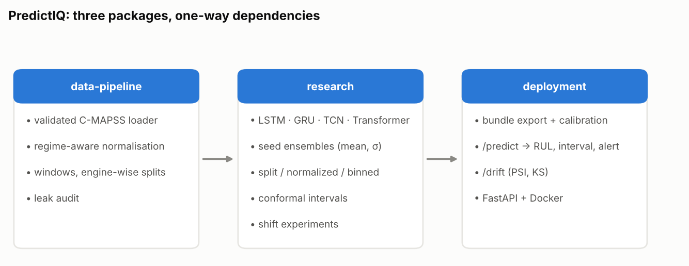
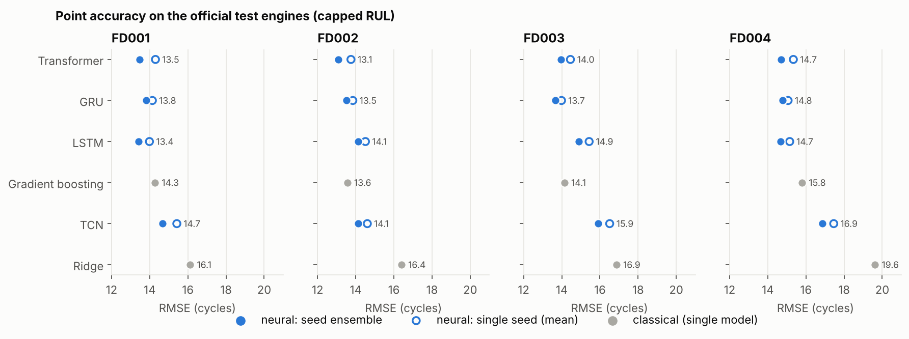
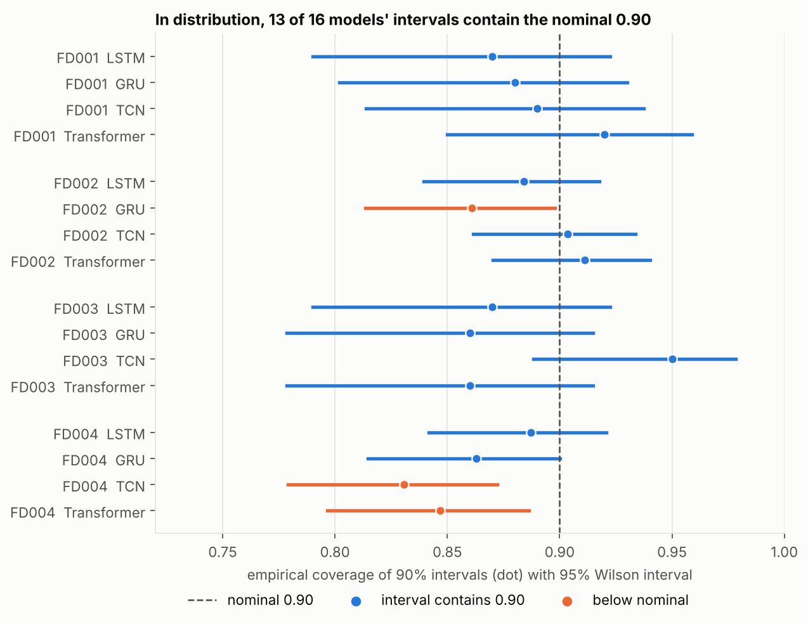
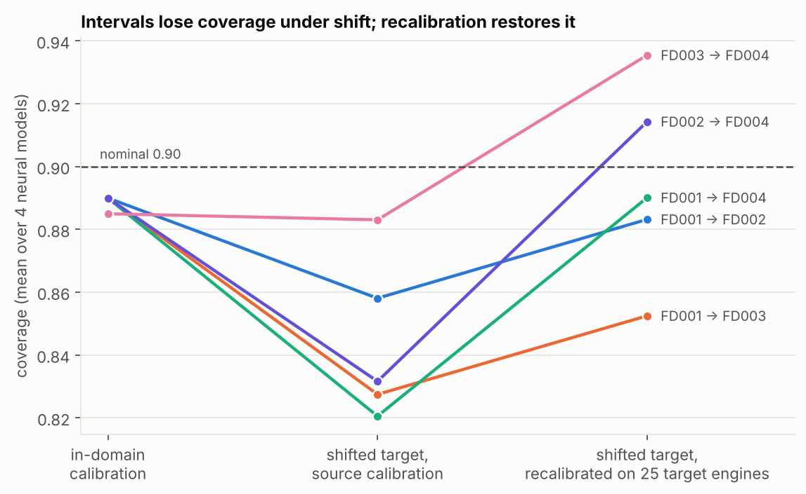
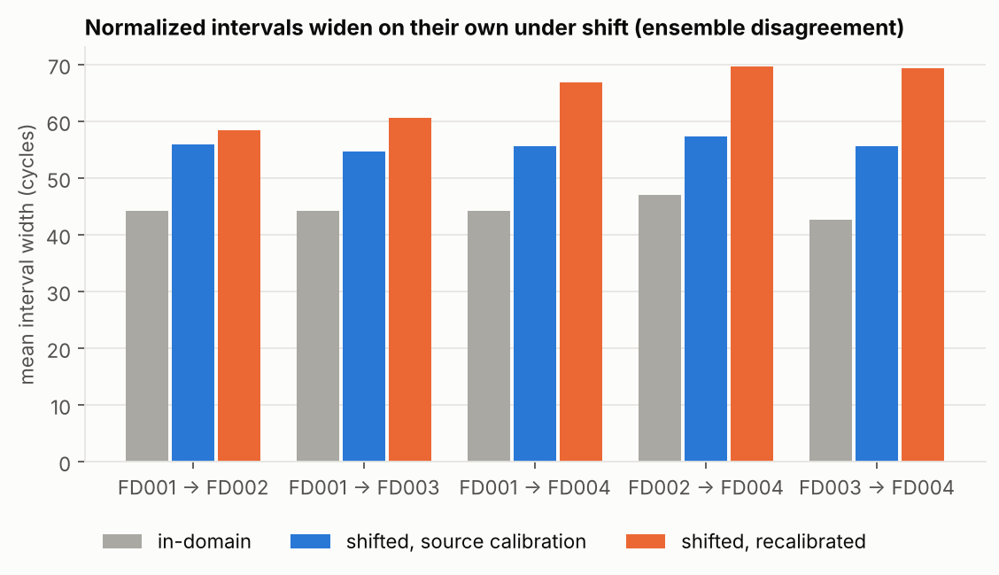
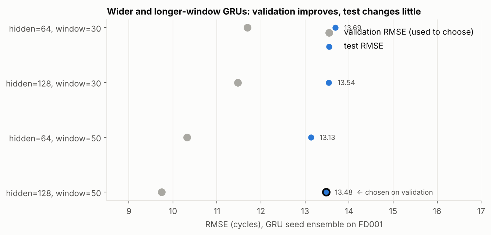
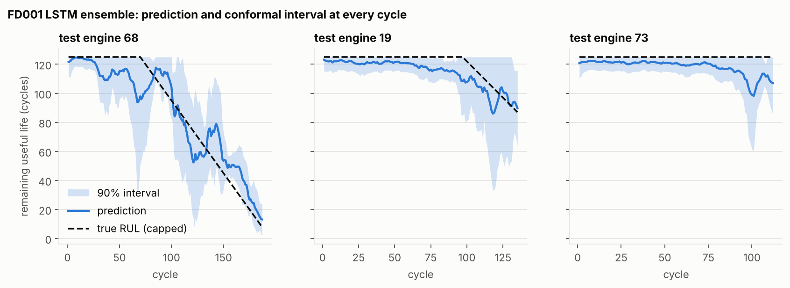

# PredictIQ

Predictive-maintenance research engineering on NASA's C-MAPSS turbofan degradation data:
**remaining-useful-life (RUL) prediction with prediction intervals whose validity is tested
under distribution shift.**

Three independently installable packages with one-way dependencies:

```
predictiq-data-pipeline  ──▶  predictiq-research  ──▶  predictiq-deployment
 load, normalise, window,      LSTM/GRU/TCN/Transformer,    export bundle, FastAPI
 engine-wise splits             conformal intervals,         service, drift checks
 (numpy, pandas, sklearn)       shift experiments (torch)
```

| Package | Responsibility |
|---|---|
| [`predictiq-data-pipeline`](predictiq-data-pipeline) | validated loading, RUL targets, regime-aware normalisation, windowing, leak-free engine splits |
| [`predictiq-research`](predictiq-research) | models, uncertainty methods (split / normalized / binned conformal written from scratch), experiment harness, report generator |
| [`predictiq-deployment`](predictiq-deployment) | model bundle export, `/predict` with interval and alert level, `/drift`, Dockerfile |



## Research question

Point accuracy on C-MAPSS is saturated, but a maintenance planner needs to know *how sure*
a prediction is. Split conformal prediction promises coverage under exchangeability, which
operating-condition and fault-mode changes break. We measure, per architecture:

1. How accurate are LSTM, GRU, TCN and Transformer regressors against feature-based
   baselines under one identical protocol (engine-wise splits, five seeds)?
2. Do conformal intervals reach their nominal coverage in-distribution, and does the
   calibration protocol (all cycles vs. random cut-offs that mimic test truncation) matter?
3. How much coverage is lost when models trained on FD001/FD003 (single operating condition)
   are applied to FD002/FD004 (six conditions, extra fault mode)? Does recalibrating on a few
   labelled target engines restore it?

The intended contribution is a careful empirical study with honest statistics, not a new
algorithm; a workshop paper on interval validity under shift in prognostics is the realistic
publication direction.

## Status

| Item | State |
|---|---|
| Data pipeline, models, conformal methods, harness, report generator, service | implemented; unit tests pass |
| Experiments on the real C-MAPSS data | run: FD001–FD004 in-distribution (5 seeds for FD001/FD003, 3 for FD002/FD004) and five shift pairs; see Results above |
| GPU / CUDA / mixed-precision code paths | written, **never executed** (the development container has no GPU); CPU paths are what the tests cover |
| Docker image | Dockerfile written, never built |
| Experiment-tracking server (MLflow) | not integrated |

## Results (real C-MAPSS data, CPU)

Complete tables: [`predictiq-research/results/REPORT.md`](predictiq-research/results/REPORT.md),
generated from the JSON files next to it. Setup: window 30, RUL capped at 125, target
coverage 90%. FD001/FD003 use 5 seeds; FD002/FD004 (3.5–4x larger) use 3 seeds to bound CPU
time. "Ensemble" = mean over seeds; classical baselines are single models, so compare them
with the *single-seed* column when judging architectures.

**Point accuracy (RMSE in cycles on the official test engines, capped RUL):**

| subset | Ridge | HGB | LSTM | GRU | TCN | Transformer |
|---|---|---|---|---|---|---|
| FD001 (100 engines) | 16.12 | 14.28 | **13.43** | 13.82 | 14.68 | 13.48 |
| FD002 (259 engines) | 16.40 | 13.57 | 14.13 | 13.52 | 14.12 | **13.08** |
| FD003 (100 engines) | 16.87 | 14.14 | 14.91 | **13.66** | 15.92 | 13.96 |
| FD004 (248 engines) | 19.62 | 15.80 | **14.67** | 14.77 | 16.86 | 14.71 |



Neural entries are seed ensembles. Single-seed RMSE is higher (for example FD001 LSTM
13.99 ± 0.42, Transformer 14.30 ± 0.37) and close to gradient boosting (14.28). The gap
between the best neural model and gradient boosting is 0.5–1.1 cycles, and the best
architecture changes with the subset; TCN is the weakest neural model in three of four
subsets (on FD002 it ties with LSTM).

**Interval validity (nominal 0.90, mean over the four neural models, normalized conformal):**

| subset | coverage, calibration on random cut-offs | coverage, calibration on every cycle |
|---|---|---|
| FD001 | 0.890 | 0.907 |
| FD002 | 0.890 | 0.899 |
| FD003 | 0.885 | 0.853 |
| FD004 | 0.857 | 0.874 |



In distribution, coverage is close to nominal but slightly low on average, and the
calibration protocol moves it by up to about 3 points. With 100–259 test engines each
coverage estimate has a 95% interval of roughly ±4–6 points (printed per model in the
report); for 13 of the 16 neural models that interval contains 0.90, and the three that fall
slightly short are FD002 GRU (borderline) and FD004 TCN and Transformer.

**Distribution shift (models trained on the source, tested on the target; mean over the four
neural models):**

| source → target | RMSE src → tgt | coverage in-domain | coverage shifted, source calibration | coverage shifted, recalibrated on 25 target engines | mean width in-domain → shifted → recalibrated |
|---|---|---|---|---|---|
| FD001 → FD002 | 13.85 → 20.39 | 0.890 | 0.858 | 0.883 | 44 → 56 → 58 |
| FD001 → FD003 | 13.85 → 23.14 | 0.890 | 0.828 | 0.853 | 44 → 55 → 61 |
| FD001 → FD004 | 13.85 → 24.76 | 0.890 | 0.821 | 0.890 | 44 → 56 → 67 |
| FD002 → FD004 | 13.71 → 24.33 | 0.890 | 0.832 | 0.914 | 47 → 57 → 70 |
| FD003 → FD004 | 14.61 → 22.20 | 0.885 | 0.883 | 0.935 | 43 → 56 → 69 |



What this supports:

- Under shift the point error grows by 47–79% in every pair.
- Coverage with the source calibration is 3–7 points below the in-domain coverage in four of
  five pairs (no drop for FD003 → FD004). In those four pairs, 3 of the 4 models have a 95%
  coverage interval lying entirely below 0.90 (0 of 4 for FD003 → FD004).
- The drop is smaller than the error increase would suggest because the normalized intervals
  widen automatically (about 44 → 56) as the ensemble members disagree more under shift.
  Ensemble disagreement is therefore a useful shift signal in itself.
- Recalibrating on 25 labelled target engines restores coverage to 0.85–0.94, at the price of
  intervals about 32–63% wider than in distribution.

What it does not support: claims about real fleets (the data is simulated), about un-capped
RUL, or significance after correcting for the many model/pair comparisons made.



**Hyper-parameter check on FD001 (GRU, 3 seeds).** To see whether the default model is far from
what tuning can reach, I varied width and window length and chose by *validation* RMSE
([`results/tuning_fd001.json`](predictiq-research/results/tuning_fd001.json)):

| configuration | validation RMSE | test RMSE (ensemble) | 90% coverage |
|---|---|---|---|
| hidden 64, window 30 (default) | 11.69 | 13.69 | 0.84 |
| hidden 128, window 30 | 11.47 | 13.54 | 0.97 |
| hidden 64, window 50 | 10.32 | **13.13** | 0.86 |
| hidden 128, window 50 (chosen on validation) | **9.75** | 13.48 | 0.84 |



Validation RMSE improves steadily with a wider network and a longer window, but the test
RMSE of the validation-chosen configuration improves only 0.21 cycles over the default, and a
different configuration is best on test; with seed spreads of 0.1–0.3 these differences are
within noise. The default configuration used throughout is therefore close to what simple
tuning gives on this data; the conclusions about interval validity do not depend on it.

**Deployment check:** a bundle exported from the FD001 LSTM ensemble and served through the
FastAPI app reproduces the research numbers on the 100 real test engines (RMSE 13.43,
coverage 0.87). The figure shows the service's prediction and interval at every cycle for
three real test engines; the dashed line is the true (capped) RUL.



## Quick start

```bash
git clone https://github.com/saaki05/project-2 && cd project-2
pip install -e predictiq-data-pipeline -e predictiq-research -e predictiq-deployment
# download and extract NASA C-MAPSS yourself, then:
cd predictiq-research && scripts/run_all.sh /path/to/CMAPSSData results
predictiq-research report --results results --out results/REPORT.md
```

Tests: `for d in predictiq-*; do (cd $d && pytest -q); done`. CI runs lint and tests for all
three packages (`.github/workflows/ci.yml`).

## Data and citation

C-MAPSS is distributed by the NASA Prognostics Center of Excellence; follow its terms of use.
A. Saxena, K. Goebel, D. Simon, N. Eklund, "Damage Propagation Modeling for Aircraft Engine
Run-to-Failure Simulation", PHM08. The data is not included here.

## Regenerating the figures

Every figure in `docs/figures/` is produced from the result files by a script (no number is
typed by hand). `pip install matplotlib`, then:

```bash
python scripts/make_figures.py --raw /path/to/CMAPSSData --bundle fd001_bundle.pt   # bundle from predictiq-export
```

## License

MIT.
